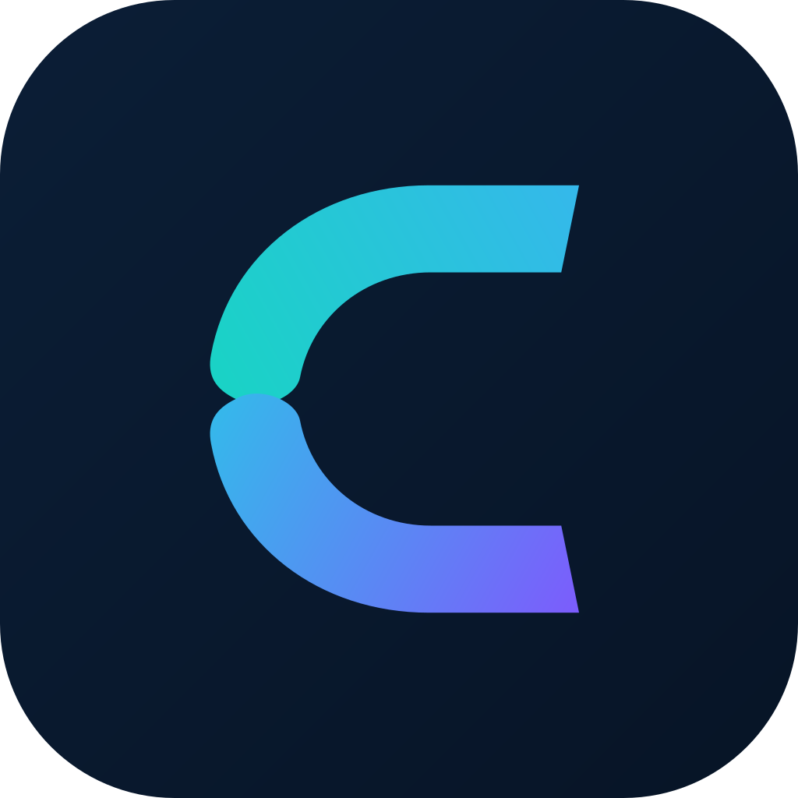

<div align="center">
  
  <h1>CLIVORA</h1>
  <p><strong>The open-source Freelancer OS for freelancers, agencies, and clients.</strong></p>
  <p>Find opportunities, manage work, collaborate with clients, and run your freelance business from one community-built platform.</p>

  [](LICENSE)
  [](https://flutter.dev)
  [](https://clivora.io)
  [](https://play.google.com/store/apps/details?id=org.codcrafters.clivora)

  [Website](https://clivora.io) · [Web app](https://clivora.io/app) · [Google Play](https://play.google.com/store/apps/details?id=org.codcrafters.clivora) · [Documentation](https://clivora.io/docs) · [Community](https://community.clivora.io)
</div>

## Why CLIVORA exists

Freelancers are often forced to combine crowded marketplaces with separate tools for CRM, proposals, projects, time tracking, invoices, files, meetings, and analytics. CLIVORA brings that workflow together and gives the community a real voice in how the product evolves.

Our ambition is to build the world's leading community-driven Freelancer OS:

- **$0 platform fee on negotiated work:** clients pay freelancers directly.
- **Opportunity plus operations:** CLIVORA Connect and daily business tools in one product.
- **Freelancer-first design:** transparent rules, private contact until mutual acceptance, and no hidden ranking promises.
- **AI with human control:** useful assistance without replacing professional judgment or user ownership.
- **Web and Android:** one account and one shared platform direction.
- **Open development:** public issues, reviewable decisions, and contributions from around the world.

> CLIVORA is a growing independent product. It is not affiliated with Upwork, Fiverr, Toptal, or Freelancer.com.

## What is included

| Area | Capabilities |
|---|---|
| CLIVORA Connect | Profiles, jobs, proposals, mutual connection, private contact |
| Business OS | CRM, clients, projects, tasks, invoices, expenses, files |
| Productivity | Time tracking, meetings, notifications, reports, analytics |
| Collaboration | Freelancer and client workspaces, messaging, teams |
| Intelligence | AI assistance, business insights, automations |
| Platform | Offline-first Flutter app, web app, Supabase backend, admin operations |

## Repository family

| Repository | Purpose |
|---|---|
| [UsmanGhias/clivora](https://github.com/UsmanGhias/clivora) | Flutter Android app, shared platform source, Supabase resources |
| [UsmanGhias/clivora-web](https://github.com/UsmanGhias/clivora-web) | Next.js marketing site, web app, and public documentation |

## Quantic MSSE Capstone

CLIVORA is also the MSSE Capstone product. The live app is the **baseline**; Capstone is a three-sprint increment (docs/tests/CI, Ask AI RAG, hire→invoice demo). It does not replace the product above.

| Grader item | Link |
|---|---|
| Live web app | [https://clivora.io](https://clivora.io) |
| Android | [Google Play](https://play.google.com/store/apps/details?id=org.codcrafters.clivora) |
| Agile board | [Issues labeled `capstone`](https://github.com/UsmanGhias/clivora/issues?q=is%3Aissue+label%3Acapstone) |
| Design and testing | [docs/capstone/DESIGN_AND_TESTING.md](docs/capstone/DESIGN_AND_TESTING.md) |
| User stories / sprints | [USER_STORIES.md](docs/capstone/USER_STORIES.md) · [SPRINT_PLAN.md](docs/capstone/SPRINT_PLAN.md) |
| What to submit | [docs/capstone/WHAT_TO_SUBMIT.md](docs/capstone/WHAT_TO_SUBMIT.md) |
| Demo script | [docs/capstone/DEMO_SCRIPT.md](docs/capstone/DEMO_SCRIPT.md) |
| Security audit (Aug 2026) | [docs/capstone/SECURITY_AUDIT_2026-08.md](docs/capstone/SECURITY_AUDIT_2026-08.md) |
| Baseline vs Capstone | [BASELINE_VS_CAPSTONE.md](docs/capstone/BASELINE_VS_CAPSTONE.md) |
| Capstone index | [docs/capstone/README.md](docs/capstone/README.md) |

Share this private repository with GitHub user `quantic-grader` before final submission.

## Quick start

### Requirements

- Flutter SDK matching the version used by the project
- Dart SDK declared in [pubspec.yaml](pubspec.yaml)
- Android Studio or another configured Android toolchain
- A separate development Supabase project for cloud features

### Run locally

```bash
git clone https://github.com/UsmanGhias/clivora.git
cd clivora
flutter pub get
flutter analyze
flutter test
flutter run
```

Never commit production credentials, signing keys, customer data, or private environment files. Use your own development services and follow the setup documentation before enabling integrations.

## Contribute

We welcome developers, designers, QA engineers, security researchers, technical writers, translators, product thinkers, and responsible AI contributors.

1. Read [CONTRIBUTING.md](CONTRIBUTING.md), [CODE_OF_CONDUCT.md](CODE_OF_CONDUCT.md), and [GOVERNANCE.md](GOVERNANCE.md).
2. Open or join an issue before starting a large change.
3. Fork the repository and create a focused branch.
4. Add tests and documentation for behavior changes.
5. Sign off your commits and open a clear pull request.

Good starting areas include accessibility, translations, Flutter quality, offline sync, testing, documentation, privacy, security, marketplace safety, and freelancer-focused AI.

If CLIVORA's mission matters to you, please **star the repository**, try the app, share constructive feedback, and help another contributor get started.

## Security

Do not report vulnerabilities in public issues. Follow [SECURITY.md](SECURITY.md) and email **contact@clivora.io** with the subject `[SECURITY] CLIVORA`.

## Licence and brand

The source code is licensed under the **GNU Affero General Public License v3.0**. If you modify CLIVORA and make that version available to users over a network, AGPLv3 generally requires you to offer those users the corresponding source code under the same licence.

AGPLv3 permits commercial use. It does **not** grant rights to present a fork as the official CLIVORA service. The CLIVORA and CODCrafters names, logos, domains, app identity, and official branding are addressed separately in [TRADEMARKS.md](TRADEMARKS.md).

Copyright © 2026 Muhammad Usman Khan, professionally known as **Usman Ghias**, trading as **CODCrafters**, and contributors.

## Support the mission

CLIVORA is being built independently with limited resources. Sponsorship, infrastructure credits, documentation help, testing, design work, and responsible engineering contributions can directly accelerate the project.

- Collaboration: [usmanghias@clivora.io](mailto:usmanghias@clivora.io)
- General contact: [contact@clivora.io](mailto:contact@clivora.io)
- Product: [clivora.io](https://clivora.io)
- CODCrafters: [codcrafters.org](https://codcrafters.org)
