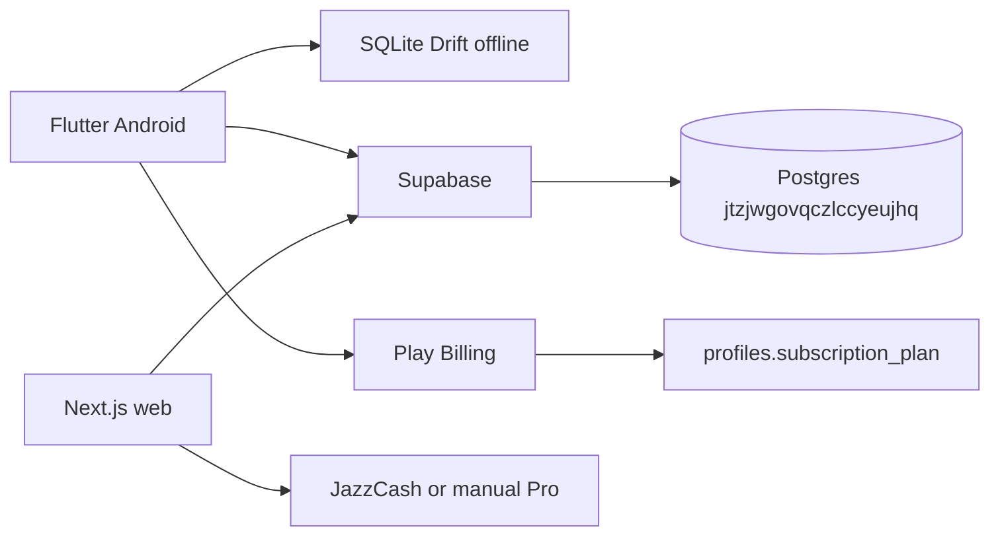

# CLIVORA localhost handoff (cloud → your PC)

**Date:** 12 Jul 2026  
**Owner:** Usman Ghias (`iusmanghias@gmail.com`)  
**Cloud agent:** https://cursor.com/agents/bc-04b4d32d-7603-4032-ab80-b5c985e2b249  

This file is the single checklist to pull everything from GitHub onto your computer and keep building locally. Nothing important lives only in the cloud agent disk after you follow this.

---

## 1. Repos and branches (clone these)

| Repo | URL | What it is | Branch to use |
|------|-----|------------|---------------|
| **Monorepo (Flutter + web source + supabase)** | https://github.com/UsmanGhias/clivora | Source of truth | `cursor/pro-plus-web-v2-7-1-d928` (or merge to `main` first) |
| **Web deploy mirror** | https://github.com/UsmanGhias/clivora-web | Vercel production tree | `main` |
| **Live site** | https://clivora.codcrafters.org | Vercel project `prj_AZuWTky7AXfyzaLkvnwK1beieGSE` | — |

### Clone on Windows / Mac / Linux

```bash
git clone https://github.com/UsmanGhias/clivora.git
cd clivora
git fetch origin
git checkout cursor/pro-plus-web-v2-7-1-d928
```

Optional web-only clone (already mirrored from monorepo `web/`):

```bash
git clone https://github.com/UsmanGhias/clivora-web.git
```

**App version on this branch:** Flutter `2.16.0+73` · Web `2.16.0`

---

## 2. Direct download links (APK / AAB / PDFs)

Release page (sign in if private):  
https://github.com/UsmanGhias/clivora/releases/tag/v2.16.0-playstore

| Asset | URL |
|-------|-----|
| APK 2.16.0 | https://github.com/UsmanGhias/clivora/releases/download/v2.16.0-playstore/clivora-2.16.0.apk |
| AAB 2.16.0 | https://github.com/UsmanGhias/clivora/releases/download/v2.16.0-playstore/clivora-2.16.0.aab |

Earlier release (status PDF + features PDF):  
https://github.com/UsmanGhias/clivora/releases/tag/v2.15.0-playstore

| Asset | URL |
|-------|-----|
| Status PDF | https://github.com/UsmanGhias/clivora/releases/download/v2.15.0-playstore/CLIVORA-Status-Done-and-Next-v2.15.pdf |
| Features PDF | https://github.com/UsmanGhias/clivora/releases/download/v2.15.0-playstore/CLIVORA-Features-and-Improvements.pdf |

Play upload cert SHA-1 (reference): `96:93:81:80:EE:59:27:D2:46:B2:BD:FC:6C:96:C6:93:2E:1A:1D:36`

---

## 3. Everything you shared with the cloud agent (inventory)

### Product / business facts you locked in
- Brand: **CLIVORA** · Company: **CODCrafters** · Site: `clivora.codcrafters.org` · Support: `iusmanghias@gmail.com`
- Pricing: **Pro $9/mo**, **Pro Plus $19/mo**
- Connect model: browse free; contact/post = Pro Plus; **$0 platform fee** on negotiated rates (no Upwork-style Connect tokens)
- Architecture: **Supabase** = cloud source of truth; Flutter SQLite = offline + outbox
- Payments: Android **Play Billing**; web JazzCash/manual (+ Stripe stubs); **do not vendor** Keycloak / Rocket.Chat / Discourse / Twenty / Kill Bill
- Google Play payments profile (docs only, not in APK): see `docs/internal/GOOGLE_PLAY_PAYMENTS_ACCOUNT.md`
  - Payments account ID `7504-8568-3035-6197`
  - Profile `0631-4490-8359`
  - Merchant ID `821322956506296398`

### Research / docs you uploaded or provided
Copied under `docs/internal/research-uploads/` and/or already in `docs/internal/`:

| File | Topic |
|------|--------|
| `deep-research-report__2/3/4_*.md` | OSS mapping, UI roadmap, 15 feature areas (report 4 is partly stale on auth/escrow) |
| Marketplace brief in chat (Upwork/Fiverr/Freelancer/Toptal + **30+ Connect requirements**) | Mapped in `RESEARCH_CONNECT_MARKETPLACE_MAP.md` |
| `CLIVORA-Roadmap-Ranking-Trust-Growth-UX*.md` | Ranking / trust / growth UX |
| `CLIVORA-Repo-Research-and-Cursor-Instructions_*.md` | Cursor instructions |
| Status write-ups / Features PDFs | `CLIVORA-Status-*`, `CLIVORA-Features-*` |

**Note:** `deep-research-report (5).md` from your Downloads folder was **never uploaded** to the agent. Paste/upload it into `docs/internal/research-uploads/` if you still need it locally.

### Screenshot / UX asks you made
- Connect Talent empty state → guest **Buy Pro Plus** for unlimited access
- Remove **all em-dashes** app-wide
- Fix marketing **hero** (content overlapping)
- Ask AI broken → fix or **download app** CTA on web
- Improve Connect on mobile (jobs/descriptions)
- Fix web **messages** (client + freelancer)
- Hub-style **icons** elsewhere
- Improve **team collaboration** on mobile

---

## 4. What we shipped together (cloud work → already in git)

### v2.14–v2.15 (baseline before latest UX)
- Connect reviews, proposals, milestones, escrow **ledger**, reputation/sort, profile completeness
- Invoice reminders Edge Function + **daily pg_cron** `0 8 * * *` UTC
- Promo **CLIVORA15** (15%, max 50)
- Web `/app/referrals`, promo on Pro checkout
- Proposal accept → kickoff milestone
- Live Hub KPIs; Android sort + conflict dialogs
- Stripe Customer Portal **stub**

### v2.16 (latest on branch)
- Em-dash purge (web + Flutter user strings)
- Marketing hero redesign + $0 fee USP
- Connect guest/free Buy Pro Plus funnel, categories, Top Rated, empty CTAs
- Ask AI: LLM if keyed else download-app mode
- Mobile Connect detail sheets, category chips, inbox status, team invite → project share
- Web Hub icon wells; role-aware Messages
- Docs + `RESEARCH_CONNECT_MARKETPLACE_MAP.md`

### Ops still manual on your side
- Vercel: paste `SUPABASE_SERVICE_ROLE_KEY` (and optional `STRIPE_*`)
- Google OAuth consent screen name = **CLIVORA**
- Play Console: SKUs Active + upload AAB from release
- Optional: `OPENAI_API_KEY` for real web Ask AI

---

## 5. Localhost setup (do this on your PC)

### A. Tools
- Git, Flutter **3.24+** (cloud used 3.44.x), Android Studio / SDK
- Node **20+**, npm
- Optional: Supabase CLI

### B. Flutter app

```bash
cd clivora
flutter pub get
flutter run   # or open in Android Studio
```

Supabase is already pointed at project `jtzjwgovqczlccyeujhq` in app config.

**Signed release builds** need `android/key.properties` (gitignored). Create it next to the keystore:

```properties
storePassword=YOUR_PASSWORD
keyPassword=YOUR_PASSWORD
keyAlias=clivora
storeFile=../clivora-upload-keystore.jks
```

Keystore file in repo: `android/clivora-upload-keystore.jks`  
(If password was only on the cloud machine, use the password you set for Play upload, or reset via Play App Signing.)

```bash
flutter build apk --release
flutter build appbundle --release
```

### C. Web (localhost)

```bash
cd clivora/web
cp .env.example .env.local
# paste SUPABASE_SERVICE_ROLE_KEY from Supabase dashboard if you need admin/AI embeddings
npm install
npm run dev
# http://localhost:3000
```

Anon key is already in `.env.example` for the live project.

Push web to the deploy mirror (same as cloud):

```bash
bash web/push-to-clivora-web.sh
```

### D. Supabase
- Dashboard: https://supabase.com/dashboard/project/jtzjwgovqczlccyeujhq  
- Migrations live under `supabase/migrations/`  
- Edge functions under `supabase/functions/` (e.g. `send-invoice-reminders`)  
- You do **not** need a second local DB unless you want one; production project is the shared backend.

### E. Open in Cursor Desktop
1. `File → Open Folder` → your cloned `clivora`
2. Checkout `cursor/pro-plus-web-v2-7-1-d928`
3. Read `docs/internal/LOCALHOST_HANDOFF.md` (this file) + `RESEARCH_CONNECT_MARKETPLACE_MAP.md`

---

## 6. Important paths on disk after clone

```
clivora/
  lib/                          # Flutter app
  web/                          # Next.js site
  supabase/migrations/          # SQL
  supabase/functions/           # Edge Functions
  docs/internal/                # All handoff + research + ops docs
  docs/internal/research-uploads/
  android/clivora-upload-keystore.jks
  web/.env.example
  web/push-to-clivora-web.sh
```

---

## 7. Architecture (do not re-litigate)



---

## 8. Next work when you are local (suggested order)

1. Merge `cursor/pro-plus-web-v2-7-1-d928` → `main` when happy  
2. Paste Vercel service role; confirm reminder email E2E  
3. Upload AAB `clivora-2.16.0.aab` to Play internal testing  
4. Continue marketplace map items marked **Later** (portfolio, Meilisearch, live escrow, etc.)

---

## 9. Secrets checklist (copy from dashboards, not from chat)

| Secret | Where to get it | Local file |
|--------|-----------------|------------|
| Supabase anon | Project Settings → API | `web/.env.local` (also in `.env.example`) |
| Supabase service_role | Project Settings → API | `web/.env.local` + Vercel |
| Resend API | Resend dashboard | Supabase Edge Function secrets |
| Stripe (optional) | Stripe dashboard | `web/.env.local` |
| OpenAI (optional) | OpenAI dashboard | `web/.env.local` as `OPENAI_API_KEY` |
| Play upload keystore password | Your password manager / Play setup | `android/key.properties` |

---

*If anything is missing from this handoff, it is either still only in a Cursor chat transcript or never uploaded (report 5). Prefer GitHub + this folder as the source of truth going forward.*
